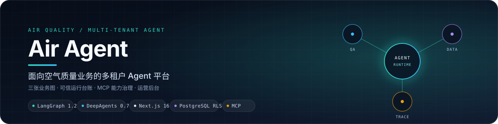
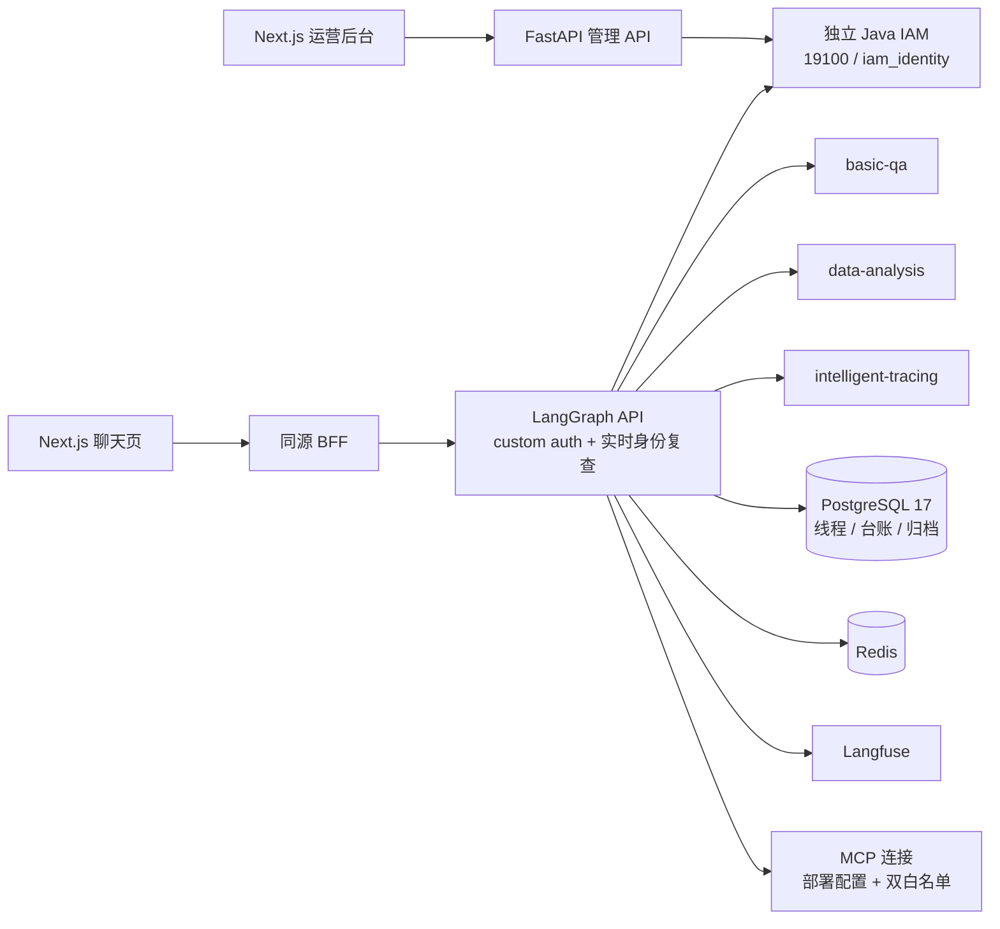

<p align="center">
  
</p>

<p align="center">
  
  
  
  
  
  
</p>

<p align="center">
  面向空气质量业务的多租户 Agent 平台：三张业务图、可信运行台账、MCP 能力治理与企业运营后台。
</p>

<p align="center">
  <a href="#核心能力">核心能力</a> ·
  <a href="#架构">架构</a> ·
  <a href="#技术栈">技术栈</a> ·
  <a href="#快速开始">快速开始</a> ·
  <a href="#文档">文档</a>
</p>

# Air Agent

面向空气质量业务的多租户 Agent 应用，提供问答、分析、报告与研究能力。Python 服务使用 LangGraph API，聊天前端使用 Next.js；当前管理 API 通过独立 Java IAM 提供身份门面，并管理 Agent 业务数据，管理页面位于 `admin/web/`。

企业运营后台仍在持续建设：运行台账、反馈、观测、能力选择和需求洞察已经落地，后续范围见 [企业化路线图](docs/enterprise-agent-roadmap.md)。

## 核心能力

- **三张业务图**：基础问答、菜单驱动的数据分析，以及受控的四专员污染溯源（冻结请求 + 确定性证据/门禁 + 统一发布）。
- **企业与访问控制**：账号、企业、部门、成员、角色、权限和审计；服务端会话可撤销，企业切换带上下文版本校验。
- **可信运行台账**：关联逻辑提问、提交、尝试、平台运行和回答；支持幂等、重新生成、恢复及独立的停止意图。
- **反馈与体验采集**：按回答版本点赞/点踩、意见、成功复制事件及可见正文计时。采集由部署开关控制。
- **业务授权**：以 IAM 的“企业开通 ∩ 本企业角色授权”为唯一人员使用资格（`agent:business:<code>:use`），普通 Skill/MCP 不再逐项做人员 RBAC；目录、受理、原生运行、恢复与逐发送共用一套守卫。
- **能力选择**：在已获准业务内提供 Skill/MCP 目录，支持 Skill 自动/单选、MCP 自动/子集/禁用；已受理计划约束主任务、子任务、重试与恢复。
- **数据分析菜单**：分析项目使用与后端 `menu_skill_mapping` 同步的原生选择器，菜单值随本轮请求冻结；运行或停止待确认时不可切换，显式 Skill 只能在该菜单映射内选择。
- **运行观测**：模型 usage、延迟、价格版本与成本、Skill 各阶段和工具结果分类，可关联 Langfuse Trace；未知数据保留缺失状态。
- **资料与画布**：归档大工具结果、按会话回读报告与可视化资料，支持删除与恢复后的墓碑重施。

能力目录不会授予额外权限。MCP 连接由平台部署配置管理（共享只读或企业连接），不再使用成员绑定；外部服务的数据范围仍需以该服务真实能力为准，受控模拟服务通过不代表生产全数据隔离完成。详见 [业务授权与 MCP 连接](docs/developer/business-authorization.md)。

## 架构



浏览器使用 HttpOnly 不透明会话，Next 服务端换取运行票据后调用 Agent。授权同时在服务端与数据库落实，历史搜索的 metadata 过滤不构成安全边界。身份唯一权威是独立 Java IAM；本仓 `admin/api/` 只保留消费门面和业务数据。

独立 IAM 已采用 **Spring Boot + Sa-Token + MyBatis + Vue**；本仓两个前端仍为 Next.js。本机运行态清单见 [运行态说明](docs/CURRENT-RUNTIME.md)，历史抽取计划不再是启动说明。

## 技术栈

| 层 | 选型 | 说明 |
|---|---|---|
| Agent 运行时 | LangGraph 1.2 · DeepAgents 0.7 · LangChain 1.4 | 三张业务图、受控调度与统一流式发布 |
| 服务端 | Python 3.13 · FastAPI · PostgreSQL 17 · Redis | 管理 API、运行台账、归档与观测 |
| 前端 | Next.js 16 · TypeScript · Tailwind CSS | 聊天、能力选择、反馈、画布与运营后台 |
| 身份与授权 | 独立 Java IAM · Sa-Token · PostgreSQL RLS | 企业开通 ∩ 角色授权，逐请求实时复查 |
| 工具与观测 | MCP · Langfuse · 事件台账 v1 | 工具白名单、Trace 关联与用量/价格观测 |
| 部署 | Apple Container · container-compose | 本地三仓统一启动，无 Docker Desktop 依赖 |

## 三仓关系

| 仓库 | 职责 |
|---|---|
| **air-agent**（本仓） | Agent 运行时、聊天前端、运营后台与业务数据 |
| [env-rag](https://github.com/Acerola-1/env-rag) | 环境标准/公报知识库与 8099 检索网关 |
| [air_agent_iam](https://github.com/Acerola-1/air_agent_iam) | 多租户身份、会话、企业与业务授权 |

## 目录导航

| 路径 | 职责 |
|---|---|
| `src/basic_qa/` | 显式业务节点流与语义 Skill 路由 |
| `src/data_analysis/` | 菜单映射驱动的确定性分析 |
| `src/intelligent_tracing/` | 受控溯源 DeepAgents 调度图：四专员、真实业务 MCP 数据源、证据门禁；Skill 材料仅内部参考，不进入在线可选目录 |
| `src/common/` | 身份、能力、模型、MCP、台账、观测、中间件与归档 |
| `frontend/` | 聊天、能力选择、反馈、画布及 Agent BFF |
| `admin/api/` | FastAPI 管理与业务 API、Alembic 迁移、引导和恢复脚本 |
| `admin/web/` | Next.js 企业/成员/权限等管理页面 |
| `docs/contracts/agent-events-v1/` | 事件登记、样本与接口契约 |
| `openspec/specs/` | 已同步主规格；活动计划与归档分别在 `changes/`、`changes/archive/` |
| `docs/reviews/` | 独立验收、失败基线、原始证据与模型评价 |

公开 Graph ID 以 [`langgraph.json`](langgraph.json) 为准：`basic-qa`、`data-analysis`、`intelligent-tracing`。

## 快速开始

需要 Python 3.13、uv、Node.js/npm，以及 macOS 上的 [Apple Container](https://github.com/apple/container) 和 [container-compose](https://github.com/Mcrich23/Container-Compose)。项目不使用 Docker Desktop。当前 compose 是本地开发栈，部分端口映射未限制为回环；对外部署应单独配置网络、密钥和暴露面。

运行时基线由 `pyproject.toml`/`uv.lock` 固定：deepagents 0.7.28、langchain 1.4.6、langchain-core 1.6.12、langgraph 1.2.16、checkpoint 4.3.0、langchain-quickjs 0.3.9。容器镜像基础层固定 digest，`docker-compose.yaml` 使用显式 tag；升级依赖需同步重生成锁、核对镜像 `/api/constraints.txt` 并重建镜像。智能溯源当前支持 PM2.5、PM10、O3、NO2、SO2、CO 六项，轨迹/PSCF 能力不可用。

根项目依赖由 `pyproject.toml` / `uv.lock` 管理；管理 API 有自己的依赖声明。一个环境联调两个 Python 项目时：

```bash
uv sync --all-extras
uv pip install --python .venv/bin/python -e './admin/api[dev]'
npm --prefix frontend ci
npm --prefix admin/web ci
```

管理 API 安装步骤用于本地联调，不能用根目录 `uv sync` 代替；再次同步根环境后如管理端依赖被清除，需重新安装。修改依赖应更新对应项目的声明和锁文件。

复制 `.env.example` 为私有 `.env` 并填写部署配置；不要提交密钥。首次启用本地 Langfuse 还需复制 `.env.langfuse.example` 为 `.env.langfuse` 并填写密钥。关键配置分工如下：

| 配置 | 用途 |
|---|---|
| `DATABASE_URI` | 管理迁移/引导使用的 owner 连接；官方 Agent 平台存储连接在 compose 中配置 |
| `ADMIN_RUNTIME_DATABASE_URI` | 宿主机管理 API 的受限运行角色，必须非 owner、非 BYPASSRLS |
| `.env.langgraph` 中的 `RUNTIME_DATABASE_URI` | 容器可达的同一受限角色连接；不能直接照抄宿主 localhost 地址 |
| `RUNTIME_TICKET_KEYS`、`INTERNAL_API_TOKEN` | 管理 API、聊天 BFF 与运行时之间的服务端身份契约 |
| `ARCHIVE_SCOPE_KEYS` | 聊天 BFF 与运行时一致配置的归档签名密钥 |
| `MAIN_LLM_*`、Embedding/检索配置 | 模型网关与能力所需服务；地址须能从实际运行环境访问 |
| MCP 连接 | `AGENT_MCP_CONNECTIONS_JSON`/`FILE` 的受保护部署配置；业务注册表与 `approved_query_tools` 双白名单；浏览器不能指定地址或凭据 |

启用 `LANGFUSE_ENABLED=true` 后，Langfuse 完整采集 SDK 可见的图/节点输入输出、系统提示与对话、模型响应、工具定义及参数结果、元数据和实际异常。2026-10-22 已按用户要求移除统一正文过滤；普通业务台账和本地日志仍按各自字段规则记录。此前已过滤的历史内容不能补回。

运行观测仅使用 Langfuse，直接采用官方 `langfuse.langchain.CallbackHandler`，在顶层绑定后由模型、工具和子代理继承，不重写 SDK 父链或 exporter。`LANGSMITH_TRACING`、`LANGCHAIN_TRACING_V2`、`LANGCHAIN_TRACING` 均设为 `false`，正式启动预检拒绝启用追踪的配置。`langsmith` 库是框架依赖，保留安装；当前 licensed 原生服务仍需私有 `.env.langgraph` 中的 `LANGSMITH_API_KEY` 进行开发启动授权，该 key 不用于启用追踪，宿主 Agent `.env` 不需要配置它。

宿主`.env`由dotenv读取；原生`.env.langgraph`使用完整literal key=value（不带shell外层引号），不要混用两套文件。

`AUTH_SECRET` 仅保留旧会话迁移用途；当前登录不再使用旧 HMAC cookie 或 `data/users.json`。Next 服务端的 `ADMIN_API_URL`、`LANGGRAPH_API_URL`、内部令牌和归档密钥需要在进程环境或私有 `.env.local` 中配置；`admin/web` 的 `ADMIN_API_URL` 默认指向本机8100。

## 启动顺序

本地完整栈使用统一启动器：

```bash
.venv/bin/python deployment/run_separated_local.py start
.venv/bin/python deployment/run_separated_local.py status
# 兼容旧命令，但只转交同一个启动器：
./run-local.sh
```

启动器会复用已有 PostgreSQL/Redis，只按需重建原生应用；首次使用前请按 `.env.example` 配置数据库、模型与 IAM 连接。完整运行态、端口与容器白名单见 [运行态说明](docs/CURRENT-RUNTIME.md) 及 [启动器说明](deployment/SEPARATED_LOCAL.md)。

## 检查与验收

```bash
.venv/bin/python -m pytest tests/unit_tests -q
.venv/bin/python -m pytest tests/integration_tests -q
npm --prefix frontend run test:contracts
npm --prefix frontend run build
npm --prefix admin/web run lint
```

管理端数据库测试需先配置**专用测试库与非 owner 角色**，在 `admin/api/` 使用上述联调环境执行 `python -m pytest tests/`；不要指向共享业务库。UI 的真实浏览器检查、实际模型/MCP联调、恢复演练与单元测试分别提供证据。

仓库保留各阶段独立验收与原始证据，见 [验收与证据](docs/reviews/)。单元测试、契约测试、真实模型/MCP 联调与浏览器验收分别记录；历史失败不会被写成通过。

## 文档

| 文档 | 内容 |
|---|---|
| [AGENTS.md](AGENTS.md) | 开发边界、不可回退约束与验收要求 |
| [UX-CONTRACT.md](UX-CONTRACT.md) / [DESIGN.md](DESIGN.md) | 聊天交互、状态与视觉约定 |
| [业务授权与 MCP 连接](docs/developer/business-authorization.md) | 企业开通、角色授权与工具白名单 |
| [企业化路线图](docs/enterprise-agent-roadmap.md) | 运营后台后续阶段与依赖 |
| [事件契约](docs/contracts/agent-events-v1/) | 台账事件、样本与接口快照 |
| [验收与证据](docs/reviews/) | 各阶段独立验收、失败基线与原始证据 |

## 继续开发

- 修改前先读 [AGENTS.md](AGENTS.md)、相关主规格及活动 change。
- UI 行为与设计约定见 [UX-CONTRACT.md](UX-CONTRACT.md)、[DESIGN.md](DESIGN.md)。
- 后台后续范围和依赖见 [企业化路线图](docs/enterprise-agent-roadmap.md)；归档表示该阶段验收关闭，不表示整个企业后台已完成。

## 维护者说明

本机正式运行态、端口、容器与数据库清单以 [docs/CURRENT-RUNTIME.md](docs/CURRENT-RUNTIME.md) 为准；README 只保留公开使用与开发说明。

## License

[MIT](LICENSE)。项目源自 LangChain starter template，原始版权声明保留在 LICENSE 中。
