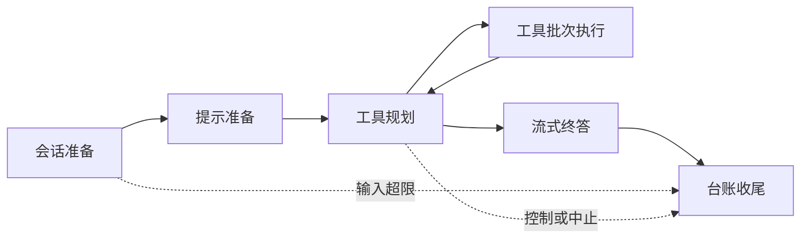

# Basic QA 当前架构

本文件描述当前源码职责。公开入口为 `langgraph.json` 中的 `basic-qa` → `src/basic_qa/graph.py:graph`。实现、测试和部署状态见 [本轮修正交接](../testing/graph-module-ownership/20261030-engineering-correction.md)；本文不构成运行验收证明。

## 六个阶段与持久化标识

| 阶段 | 实现入口 | 持久化节点ID |
| --- | --- | --- |
| 会话准备 | `BasicQANodes.prepare_session` | `classify_intent` |
| 提示准备 | `BasicQANodes.prepare_prompt` | `prepare_model` |
| 工具规划 | `BasicQANodes.plan_tools` | `call_model` |
| 工具批次执行 | `ToolBatchExecutor.run_tools` | `execute_tools` |
| 流式终答 | `BasicQANodes.compose_answer` | `answer_model` |
| 台账收尾 | 公共 `make_ledger_finalize_node` 装配的节点 | `ledger_finalize` |

节点ID沿用现有检查点标识，不承担新的职责命名。普通交流、澄清和复述也先经过规划，再进入无工具的终答；规划阶段不直接发布正文。`finish_planning` 是模型可选的结束信号，不是图节点。不存在独立意图分类或自动单选 Skill 节点。

## 文件职责

- `graph.py`：正式工厂、可信策略装配和追踪入口。
- `builder.py`：节点注册、条件边和编译；不实现工具批次。
- `nodes.py`：四个模型／会话节点。规划重试、空回复补救、规划结果写回、终答恢复和终答写回各有独立方法，节点负责阶段串接。
- `tool_batches.py`：整批冲突检查、加载串行执行、累计更新和统一使用记录写回。普通业务调用仍交给 ToolNode 并发执行。
- `tool_policy.py`：模型消息、tool_call、当次定义、schema和真实参数的绑定核对；入口和真实发送两层检查继续保留。
- `tool_runtime.py`／`tool_recovery.py`：本图的工具重试、错误补救、结果治理和轮次预算。
- `prompts.py`：本图系统提示组装。能力规则投影由 `capabilities/projection.py` 提供。
- `capabilities/runtime.py`：有效会话引用、旧版本迁移和按需加载工具。
- `capabilities/projection.py`：当前材料／schema选择、历史加载回执投影与容量休眠；返回具名 `CapabilityProjection`，不改变持久化状态结构。
- `capabilities/tool_definitions.py`：稳定工具身份与当次模型定义记录。投影、执行和观测分别依赖它；它不依赖这些控制器。
- `capabilities/errors.py`：能力解析异常契约，目录不为取得异常类型而反向依赖运行控制器。
- `capabilities/skill_search.py`／`skill_materials.py`：受理范围内的 Skill 搜索、材料解析和版本核对。
- `capabilities/mcp_catalog.py`／`mcp_search.py`／`mcp_index.py`：合法工具目录、搜索与索引存储。
- `capabilities/observation.py`／`state.py`：能力事实观测和能力引用状态变换。
- `context/`：本图的请求准备、摘要水位、资料投影、结果治理与一次超窗恢复。

依赖方向为图 → common；application 通过固定映射装配图策略。数据分析继续拥有自己的上下文和工具流程，不使用 BQA 控制器。只读材料、纯领域规则、计量和存储按职责共享，不按消费者数量机械迁移。

## 路由与状态语义

会话入口沿用 `intent` 键，当前 `INPUT_ACCEPTED` 对应 `data_query`，`INPUT_OVERFLOW` 对应 `input_overflow`，仅表示输入校验结果。规划结束路由读取服务端 `control_code` 或 `output_aborted`；`ui_visible` 只表示展示意图，不作为结束依据。实际控制消息沿用公共发布器的现有协议。

当前能力引用为 `bqa_capabilities`，当次实际模型工具定义记录为 `bqa_disclosure`。search／load管理模型上下文，不授予额外工具权限；执行仍核对真实授权、当次定义和调用绑定。

`bqa_active_skill` 仍有旧版本迁移读点：必须证明历史加载调用、回执、材料及归属后才能迁入 v2。`needs_planning`、`user_id`、`skill_rules_content` 仅保留旧通道；其中旧规则字段在新轮初始化时仍清空。身份始终来自可信运行上下文。

`data_model_started_at` 是公共计算工具读取的计时契约，数据分析也写入同名字段；本轮不单侧更名。消息、摘要及成功覆盖水位继续按现有键写回。任何节点或字段退役都需要单独处理旧检查点、暂停线程和回退证据。

## 验收边界

本轮用户要求只做 Python 源码编译。既有受控图和 SQLite 恢复用例已同步引用，尚未在修正后运行；正式 PostgreSQL升级矩阵与独立评审继续待验收。测试交由 DeepSeek，不以源码编译通过声称行为等价、图加载成功或正式上线。

## Skill 发现与受理边界

新能力优先 `search_skills`，从至多五项候选中 `load_skill`；首次请求不含完整 Skill 目录、简介或触发词。有效加载引用跨轮复用，休眠引用可重新加载。search/load 管理模型上下文，不授予权限，未覆盖部分继续按需搜索独立工具。

请求使用 `agent.capability-selection.v2`，只保留 MCP 范围和可选目录版本；不再接受 Skill auto/explicit 或事先指定 Skill。旧运行配置字段被拒绝，选择摘要版本升级为 3；历史快照原摘要保留，旧选择不能 retry/resume。新迁移只准备在业务库升级时应用，本次代码修改不代表已升级正式库或部署。
