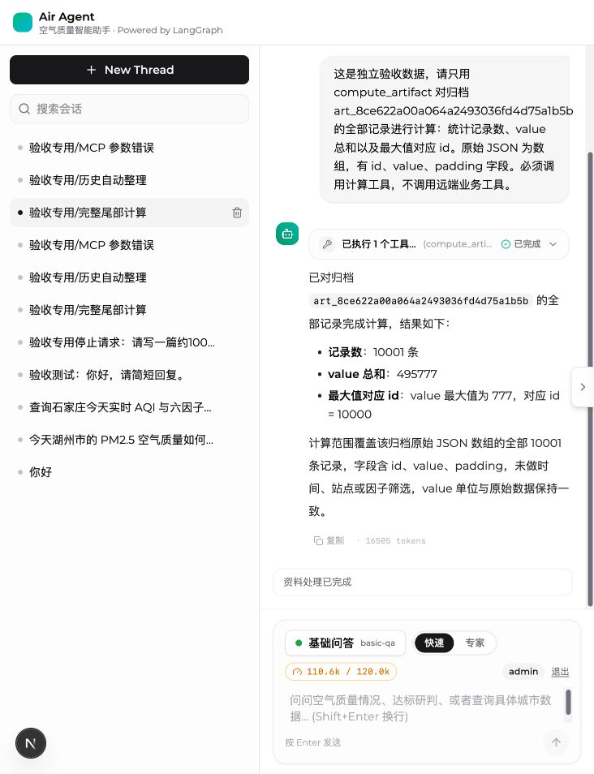
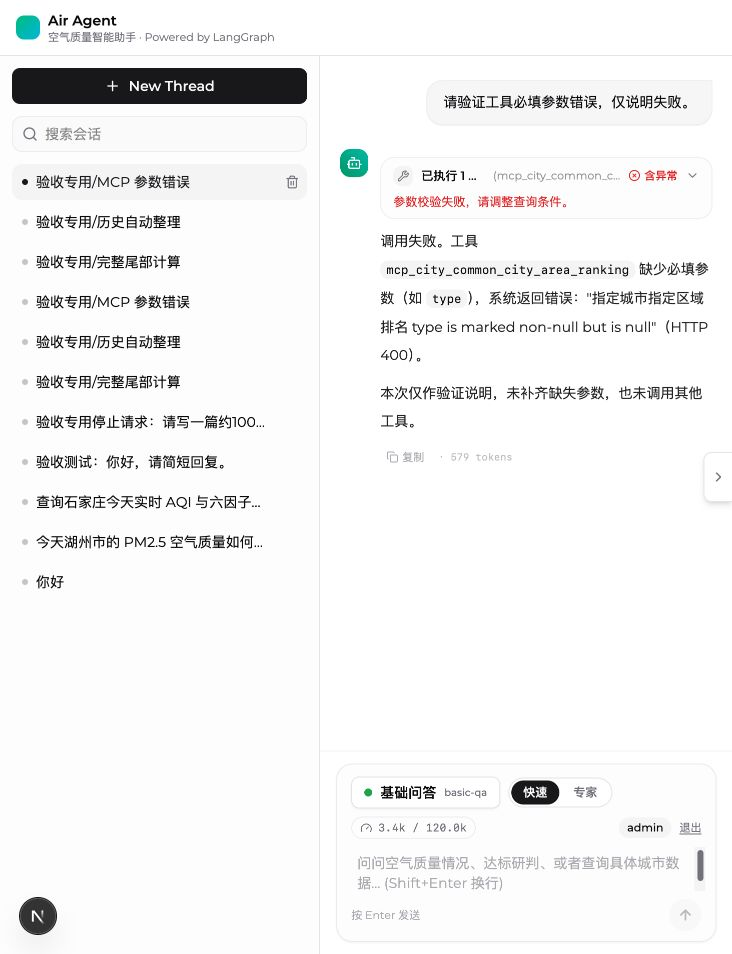
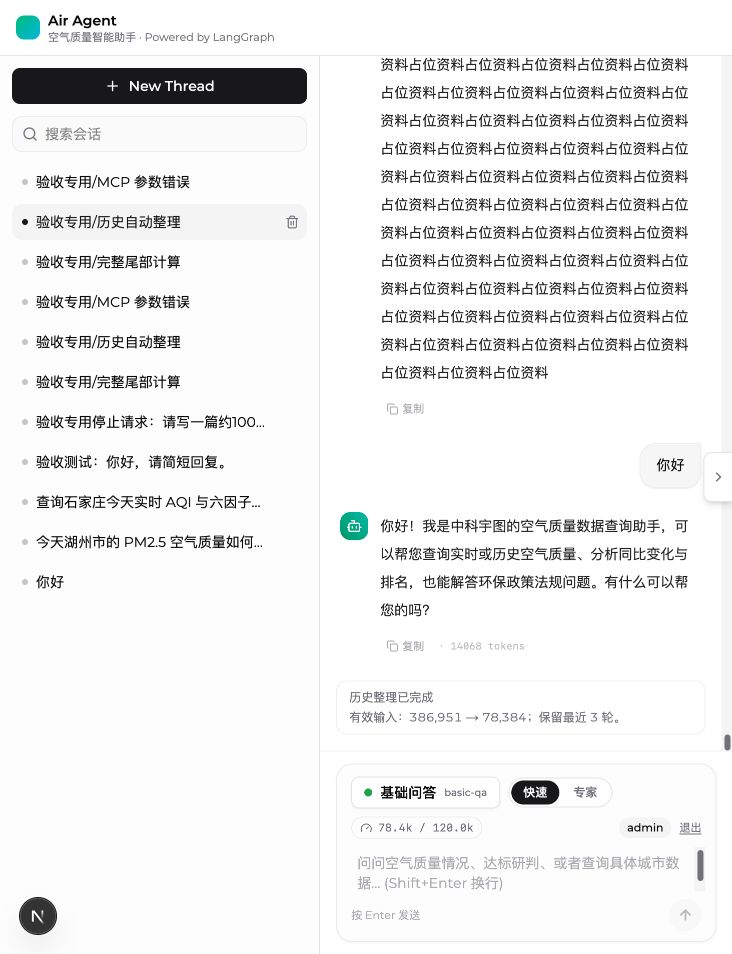
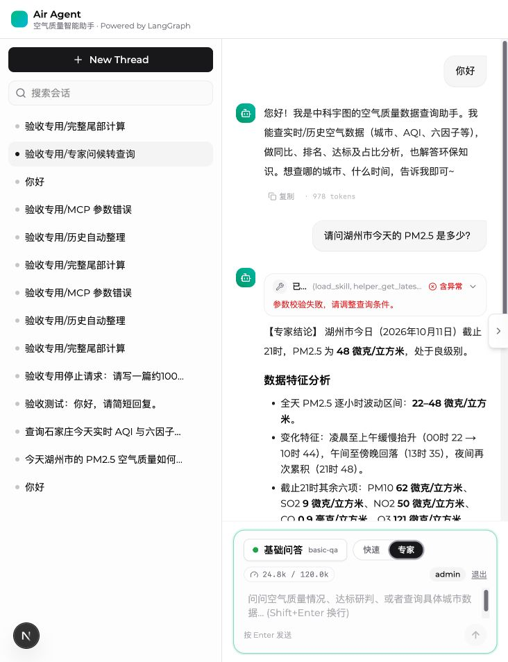
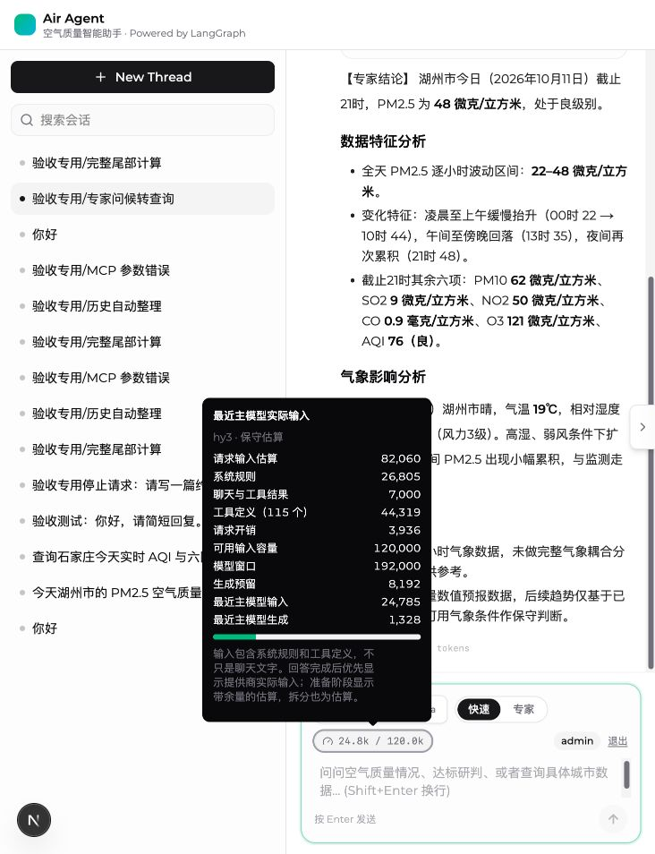

# LangGraph 前后端治理实施验收

日期：2026-10-11。基线：`2ec4b9f`，本次改动尚未提交。范围为 `basic-qa`、`intelligent-analysis`、`data-analysis` 及现有聊天前端；DeepAgents 图的内部流程和计算工具注册未改动。

本次已完成 OpenSpec 计划及实施。初轮验收遗漏了专家模式从问候转入真实城市查询的常规场景，用户反馈后补充复现、修正和回归，见下方追加记录。早期评估记录中的问题与模拟探针保留在原评估文档中，本报告说明实施后的验证结果。

## 问题原因与修复结果

工具错误明文闪现来自流协议和页面展示之间的契约缺失：SDK 的原始消息流包含工具响应和内部模型草稿，清洗之前可能被临时当作聊天正文。后端返回普通 JSON 业务错误时也未统一标记为失败；前后清洗生成不同消息身份还可能形成重复答案。

现在正文只接受确认可见的状态消息，原始工具流、摘要和草稿不进入正文。终答清洗后使用稳定身份替换；工具业务错误统一转为失败卡和可读说明，诊断 JSON 需要主动展开。模型生成或清洗被输出上限截断时明确说明未完整生成，不展示半段答案。为保证这一契约，三个显式图的终答先完成内部生成和清洗，再发布完整正文；用户仍可看到工具和处理阶段进度。

历史消息保留在 checkpoint，模型输入使用成功摘要的覆盖水位及最近完整轮次。摘要失败不会推进水位。页面显示历史整理阶段、整理前后有效输入及保留轮数，刷新后恢复这些状态，不显示内部摘要。提供商实际 usage 与准备请求的预算估算分开呈现。

完整请求预算包含系统提示、工具参数、工具定义和消息，工具说明按预算逐级精简但保留参数约束。摘要模型窗口、输出预留与安全余量独立配置，完整文本按可用输入分批并分层合并。原来的固定前缀截取已移除；更换模型需要更新窗口配置，服务不会仅凭模型名称推测容量。

结构化原文可靠写入 PG 后返回归档引用和有界 manifest；完整数组通过隔离进程中的 QuickJS 计算。实现时间、内存、输入及结果限制、一次修正、覆盖计数、来源关联和取消回收。JavaScript 不获得网络、文件、shell 或包安装能力。固定污染等级函数对资料中未给出或冲突的边界明确拒绝。

归档按可信用户和线程授权，支持分页回读、到期提示、清理及线程删除联动。PG 失败不静默切换存储，也不产生虚假的已保存引用。前端取消实际通知服务端；线程和运行隔离防止晚到回调覆盖新会话，用户上翻时停止自动跟随。

## 实际环境证据

浏览器使用提供的本地测试账号登录，密码未写入文档或代码。后续自动验收从本地认证配置生成短期测试会话，不打印或保存凭据。实际链路包含 Next.js 同源代理、容器 LangGraph API、配置的模型通道与 PG。

| 验收项 | 实际结果 |
|---|---|
| 全量尾部计算 | 10,001 条合成 JSON 记录，共 717,964 字符；覆盖计数 10,001/10,001；总和 495,777；最大值 777，位于最后一条，id=10,000 |
| 历史自动整理 | 有效输入估算 386,951 → 78,384；保留最近 3 轮；全部 22 条消息仍在 checkpoint；关键词保留，页面刷新后状态恢复 |
| 真实 MCP 参数错误 | 实际 `mcp_city_common_city_area_ranking` 返回业务 code=400；工具状态 error；默认页面显示“参数校验失败，请调整查询条件。”，原始 JSON 仅展开诊断后可见 |
| 归档权限与生命周期 | PG 原文分页回读；未登录 401；跨用户 403、跨线程 404；过期 410 且清除负载；专用测试线程删除后归档清除 |
| 三个显式图 | basic-qa 覆盖计算、压缩与错误场景；intelligent-analysis 和 data-analysis 实际模型运行均返回唯一可见终答与预算信息 |
| 停止与恢复 | 浏览器停止后实际 API run 为 interrupted；上翻后的滚动位置保持 0；下一次中文消息运行成功、发送框恢复 |

全量计算使用合成验收数据直接存入 PG，随后由真实模型、真实 QuickJS、真实 LangGraph API 和 PG 完成计算与派生归档；它不是实际业务 MCP 的超大返回。400 场景另行调用了真实 MCP 服务。完整文本分批摘要的覆盖和异常处理由针对性测试验证；未额外制造真实模型对超长非结构化文本的压力验收。

实际浏览器验证了折叠错误卡、键盘展开诊断、原文第一页及下一页、过期提示、上下文整理展示、刷新恢复、停止和新消息发送。保留了输入法组合态的提交保护并验证普通中文 Enter 提交；未模拟系统输入法候选窗的全部组合态。浏览器可见页面和契约测试共同验证默认正文不显示工具 JSON；并未通过逐帧录屏证明所有可能运行的每一帧。

主动展开诊断的截图：`evidence/2026-10-11/mcp-400-expanded.jpg`；实际过期提示：`evidence/2026-10-11/archive-expired.jpg`。这两张截图来自此前同版本功能验收，不对应最后一次自动重跑生成的线程 ID。

## 检查结果

| 检查 | 结果 |
|---|---|
| 直接相关 Python 单元／ToolNode 集成测试 | 55 passed，8.52 秒 |
| 真实环境集成验收 | 6 passed，82.34 秒 |
| 前端正文／运行隔离／认证代理契约 | 6 passed |
| TypeScript | `tsc --noEmit` 通过 |
| 前端生产构建 | Webpack 构建通过；既有认证库 Edge 导入及 middleware 迁移提示保留 |
| Python 格式与静态检查 | 本次 37 个 Python 文件 Ruff 检查和格式检查通过；针对性类型检查无错误，动态 SDK 类型警告保留 |
| OpenSpec 与差异格式 | 严格验证及 `git diff --check` 通过 |
| 完整旧单元集（排除已下线 Vanna 测试） | 193 passed、26 skipped、10 failed |

完整旧单元集未全绿。10 项失败位于未修改的 checkpoint 连接关闭测试（1 项）、旧 knowledge_route 缓存接口测试（4 项）、已移除 datacenter MCP 客户端接口测试（5 项）。另外 `test_vanna_visualization.py` 因已下线模块 `common.config.vanna_sql_adapter` 无法收集，完整检查明确排除了该文件。没有为了通过旧测试重新引入退役实现，也不把这些失败记为本次通过。

复验命令和配置含义见 `../langgraph-context-governance.md`。依赖锁审计确认已有包版本未变，仅增加 `psycopg-binary==3.3.4`，解决宿主机纯 psycopg 缺少 libpq 的实际问题。QuickJS 使用既有锁定依赖。自定义 HTTP 应用注册同步到 LangGraph 配置、Dockerfile 和本地 compose 环境。

## 运行边界与交付状态

- 不支持的污染边界（例如未给出的新 PM 分界、PM2.5 日均，以及 SO2 小时 800 的重叠规则）会明确拒绝，不能据现有材料补造标准。
- 完整扫描计数能阻止前缀结果冒充完整处理，不能从数学上证明任意生成脚本的业务逻辑都正确。实际精确结果保留代码、覆盖及原文来源用于复核。
- 初轮采用 UTF-8 字节上界曾错误拒绝专家模式普通查询，现已修正为带余量的多语言近似。近似不保证数学上界，提供商实际 usage 单独展示；完成后的仪表优先显示实际主模型输入。
- 保留完整 checkpoint 历史会使长期会话的持久化与页面加载负载增长，本次没有引入历史分页。
- 当前直连 `:2024` 的原有 noop 认证仍属于可信本地开发边界。认证代理及归档授权已验证，不能据此宣称后端端口可直接安全暴露公网。
- 本地模型网关原地址不匹配当前容器网段，已在忽略的 `.env` 中修正为实际宿主网关并经真实请求验证；未公开密钥。
- 保留最终计算、压缩、400 和停止会话供页面复核。最后一轮按标题批量清理被自动审批拒绝，未执行该次删除；多余验收样本仍保留。原有用户业务会话未修改。

OpenSpec 任务已完成；未提交、推送或自动归档。所有确认通过与尚未覆盖的情况如上说明。

## 用户反馈后的容量误判修正

用户截图中的原会话仅两条提问和首条回答，共 121 字符，却被报为 128,082 / 120,000 并拒绝。只读取与截图两条提问完全一致的该会话，核实模型为 hy3、来源为 `estimate:utf8-upper-bound`、专家系统提示为 18,483 字符。原因是未知分词器时把全部请求的 UTF-8 字节上界直接用作拒绝门槛，加上 115 个工具的参数定义与专家规则，造成严重高估。初轮真实验收没有覆盖专家模式的这一常规转入场景，先前完成声明不能替代该场景的验证。

修正包含：独立 tokenizer 编码覆盖；无专用编码时区分 ASCII／中日韩／其他 Unicode 的估算并默认乘 1.25 余量；可精简工具定义时目标占输入预算 40%，为结果留空间且不删参数约束；公开完整请求组成；有提供商 usage 时仪表优先显示最近主模型实际输入，无 usage 的准备阶段显示 ≈ 估算。输入预算 120,000、模型窗口 192,000 与输出／安全预留没有为通过验收而提高。

在独立验收线程以专家模式实际执行“你好 → 请问湖州市今天的 PM2.5 是多少？”，真实模型与 MCP 完成查询。最新主模型实际输入 **24,785**，输出 1,328；请求估算 82,060，其中系统规则 26,805、聊天与工具结果 7,000、工具定义 44,319、请求开销 3,936。实际调用 6 次工具，含两次业务参数失败，随后其他查询工具返回数据并生成答案；本项证明容量保护未再误挡，不表示所有工具请求均成功，也没有独立核验返回浓度在外部观测源上的真实性。原用户失败会话保持原有记录，未改写历史答案。

补充验证：相关 Python 58 passed；真实专家转查询／历史压缩／全量尾部计算 3 passed（101.64 秒）；前端契约 7 passed（新增实际值优先与估算标识的组件渲染验证）；TypeScript 和生产构建通过；针对性类型检查 0 errors，57 warnings。完整旧测试集的基线失败说明保持不变，本轮没有再次运行完整旧集。

压缩回归按新口径得到 241,889 → 49,144，保留 3 轮，实际主模型输入 13,153；全量计算仍覆盖 10,001 / 10,001，计数 10,001、总和 495,777、最后一条最大值 777（id=10,000）。估算来源变化会改变页面和触发阈值的数值，但完整历史保留和覆盖水位契约保持。

