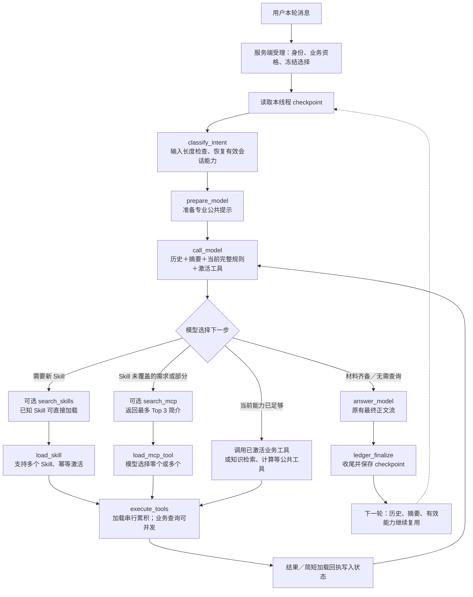

# Basic QA 实际流程（会话能力 v2）

这是当前实现的原生 LangGraph。搜索、加载、业务查询都由模型在循环中按需选择，图不会每轮先做向量匹配。部署和分层验收状态以[实施记录](implementation.md)为准。

图中的搜索、加载和查询是`execute_tools`处理的不同工具调用，分开展示是为了说明业务意义，并非新增独立 StateGraph 节点。每个搜索结束后，模型都会先看到候选，再自行决定是否加载；每次加载结束后，下一次模型请求才带上新规则／schema。本批刚加载、尚未向模型披露的新工具不能在本批提前查询；已经披露的有效工具可与新加载同批执行。

`call_model`和`answer_model`发送前共用能力投影、上下文计量及原有摘要机制；容量不足时先整理历史，再休眠较久未用且本次不必需的能力。引用保留，之后可以用load重新激活。取消、身份撤销、超时、八批次上限及容量不足会按现有机制停止；这些异常边没有在主流程图中逐条展开。

连续三城的正常路径是：首轮湖州加载空气质量Skill并查询；“那杭州呢？”和“那金华呢？”结合历史理解对象，直接复用有效工具，只改变查询参数。复述、感谢不需要业务查询。专业范围外的问题简短说明业务范围并引导回来。

当前实现仍注册`resolve_skill`以兼容其他调用方，但Basic QA条件边不会进入它。`classify_intent`沿用旧节点名，在Basic QA这里只做输入检查和会话初始化，不再用“那杭州呢？”这几个字的分类结果锁定Skill。

全部109项工具定义保留在程序侧，工具检索只给Top 3简介，只有激活的少量schema进入模型。会话激活也不替代现有业务资格、部署连接白名单及本次受理选择；每次真实发送仍复查。没有新增时间／城市回显校验或最终答案门禁。
