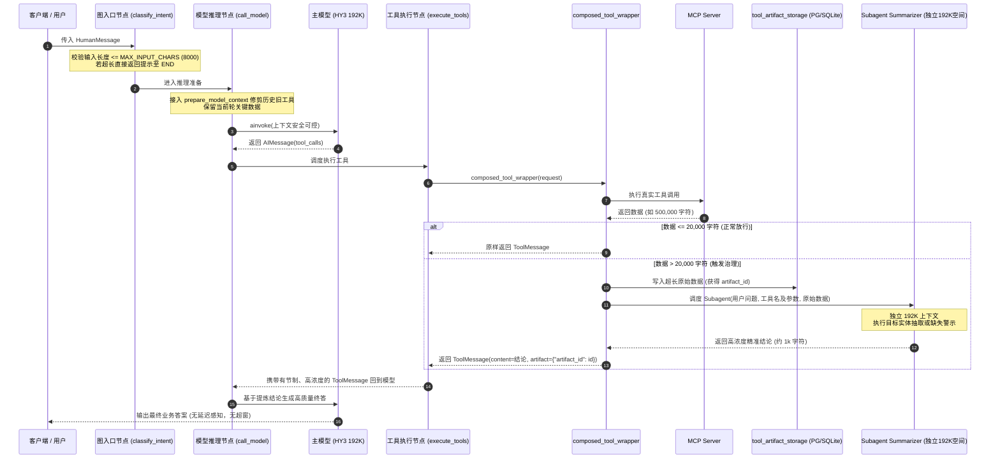

# 架构设计说明：MCP 工具治理与上下文工程

## 1. 架构总览与核心时序

本设计采用“**执行层透明 Subagent 提炼 + 数据库外置落库 + 调用层只读上下文修剪**”三位一体的分层治理架构：



## 2. 统一环境变量配置设计

在 `src/common/config/settings.py` 中新增如下配置项：

```python
# 模型与上下文全局预算
MODEL_MAX_CONTEXT_TOKENS: int = 192_000         # 主模型官方上下文窗口 (HY3 默认为 192K)
MAX_INPUT_CHARS: int = 8_000                    # 用户单次提问输入字符上限
TOOL_OUTPUT_SUMMARY_THRESHOLD_CHARS: int = 20_000 # 触发 Subagent 总结的单次工具字符阈值
MODEL_CONTEXT_BUDGET_TOKENS: int = 120_000       # 多轮会话模型调用的安全 Token 预算
SUMMARY_LLM: str | None = None                  # Subagent 提炼模型名称 (为 None 时复用 main_llm)
```

## 3. 专属数据库表设计 (`tool_artifact_storage`)

为避免 Checkpointer 数据库（`checkpoints` 表）因保存大对象而发生膨胀，同时避免容器多实例环境下的本地文件不一致，建立专属表集中存储大工具载荷：

### 表结构定义 (DDL)
```sql
CREATE TABLE IF NOT EXISTS tool_artifact_storage (
    artifact_id VARCHAR(64) PRIMARY KEY,
    tool_call_id VARCHAR(64) NOT NULL,
    tool_name VARCHAR(128) NOT NULL,
    char_length INT NOT NULL,
    raw_payload TEXT NOT NULL,
    summary TEXT,
    created_at TIMESTAMP DEFAULT CURRENT_TIMESTAMP
);

CREATE INDEX IF NOT EXISTS idx_tool_artifact_call_id ON tool_artifact_storage(tool_call_id);
```

### 轻量引用协议
存入数据库后，写入 LangGraph State 的 `ToolMessage.artifact` 仅保留轻量元数据字典：
```json
{
  "storage_type": "database",
  "table": "tool_artifact_storage",
  "artifact_id": "art_20261010_abc123",
  "tool_call_id": "call_xyz",
  "char_length": 524180
}
```
Checkpointer 持久化该结构体仅消耗几十字节，零存储膨胀。

## 4. Subagent 智能提炼设计 (Subagent Summarizer)

### 独立上下文隔离
Subagent 不继承主图的 `messages` 列表，使用独立的无状态单次调用（One-shot LLM Invoke），运行在独立 192K 上下文空间内，其输入仅包含：
1. **用户原始提问**（例如：“北京市海淀区今天空气质量如何？”）
2. **工具调用信息**（工具名与参数，例如：`mcp_weather_forecast(region="")`）
3. **超长原始数据**（50 万字符原始 JSON）

### 提炼 Prompt 策略
```markdown
你是一个专业的数据精炼助手。当前工具调用返回了超大数据集（共 {char_length} 字符）。
用户当前的问题是："{user_question}"
工具调用信息：{tool_name}，参数：{tool_args}

请执行以下精准提炼规则：
1. 目标实体精准抽取：若数据中包含用户所询问的目标对象（如特定省份、城市、区县或时间段），请精准提取该目标的数据指标，彻底过滤掉其他无关实体的数据噪音；
2. 缺失显式警示：若通读全量数据后，确认数据中【根本不包含】用户所询问的目标对象（例如用户问海淀区，但数据全是其他省份或因参数缺失返回了无用集合），必须明确警示："【数据警示】工具返回了大量数据但未包含目标实体 [{target}] 的数据，可能由于参数缺失或过滤条件未生效，请核实"，切勿捏造；
3. 输出紧凑结构化：输出必须精炼，保留核心数值、单位与时间，长度严格控制在 1000 字符以内。
```

### 容灾降级
若 Subagent 提炼调用因超时或异常失败，执行安全降级：
- 截取原始数据的前 2000 字符 + 末尾 500 字符构造样本预览；
- 附带警示信息：`"工具返回超大数据已存入数据库(artifact_id={id})，子代理提炼超时，以上为截断样本"`；
- 确保绝对不会将未处理的 50 万字符直接打给主模型。

## 5. 模型调用前只读上下文修剪算法 (Model Context Guard)

在 `call_model` 节点内，将 `state["messages"]` 转换为输入 `full_messages` 时执行只读投影：

### 算法约束与规则
1. **当期轮次绝对豁免**：以最后一条 `HumanMessage` 为界，其后的所有 `AIMessage` 与 `ToolMessage` 均视为当前轮次，**100% 完整保留，绝对不修改、不修剪**；
2. **历史轮次工具载荷置换**：计算总消息 Token 估算值。若总量超过 `MODEL_CONTEXT_BUDGET_TOKENS`：
   - 遍历历史已完成轮次中的 `ToolMessage`；
   - 将其 `content` 替换为紧凑占位符：`"[历史工具数据已由上文结论提炼，详细数据已归档]"`；
   - 将对应的历史 `AIMessage.tool_calls` 中的 `args` 清空为 `{}`；
   - 保留 `ToolMessage.tool_call_id` 严格对应，保证 API 协议合法；
3. **只读保证**：所有修改仅作用于传给 `model_with_tools.ainvoke` 的内存数组副本，**严禁修改 `state["messages"]`**，确保 Checkpointer 历史审计与前端历史展示 100% 保真。

## 6. 多轮纯文本大模型会话摘要架构 (Conversation Summarizer)

当对话轮次持续累加，即便工具内容已被修剪，用户与 AI 的纯对话历史本身也会持续膨胀。为彻底解决极端长会话超窗隐患，架构引入渐进式大模型会话摘要：

### 核心机制
1. **状态字段引入**：在 `BusinessGraphState` 中引入 `summary: NotRequired[str]`，由 Checkpointer 自动持久化保存；
2. **触发水位线**：
   - `CONVERSATION_SUMMARY_THRESHOLD_TOKENS=30000`（待压缩早期历史 Token 阈值）；
   - `CONVERSATION_SUMMARY_KEEP_TURNS=3`（保留最近 3 轮最新完整对话不压缩，保持活跃上下文连贯）；
3. **滚动提炼（Snowball Summarization）**：
   - 提取早于最近 3 轮的历史消息；
   - 调度 Summarizer LLM：输入已有的 `state["summary"]` + 早期消息列表；
   - 产出精简全局摘要（讨论要点、已得出的业务结论、核心决策与用户偏好，控制在 1000 字符内）；
   - 写回 `state["summary"]`；
4. **模型调用前注入**：
   - 在 `prepare_model` / `call_model` 中，若存在 `summary`，自动作为系统背景注入 `full_messages` 开头：`## 早期对话历史摘要\n{summary}`；
   - 送入模型的有效消息列表中，早期的原始轮次被安全过滤，只保留最近 3 轮活跃对话；
   - 原始 Checkpointer 仍保存完整 messages，保证前端历史气泡渲染与报告导出零数据丢失。

## 7. 异常与系统边界控制

- **HITL 中断透传**：在 `tool_wrappers.py` 中，显式排除 `GraphBubbleUp` 异常，遇到 `except GraphBubbleUp: raise`，确保 LangGraph `interrupt()` 挂起机制不被破坏；
- **Command 支持**：若工具返回 `Command` 对象，直接放行，不强制转为 ToolMessage；
- **异步安全**：数据库读写、Subagent 与 Summarizer 推理均采用原生 `async/await`，不阻塞并发工具调用。

